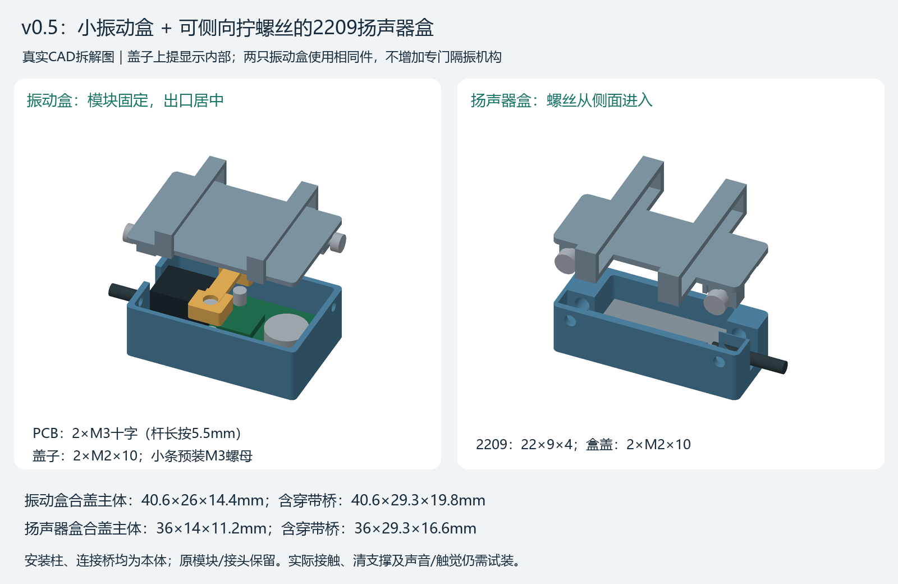
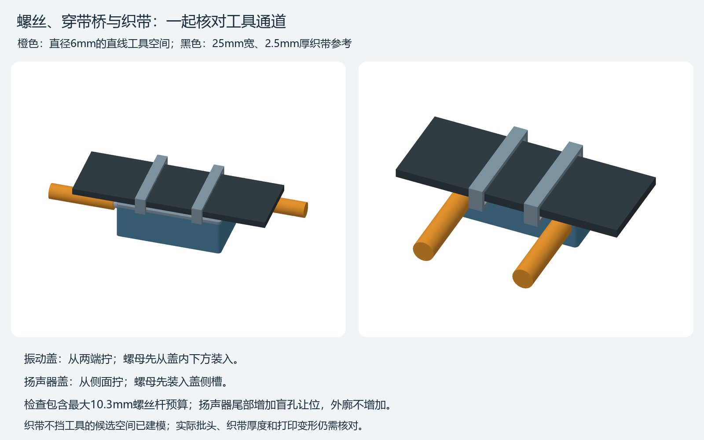
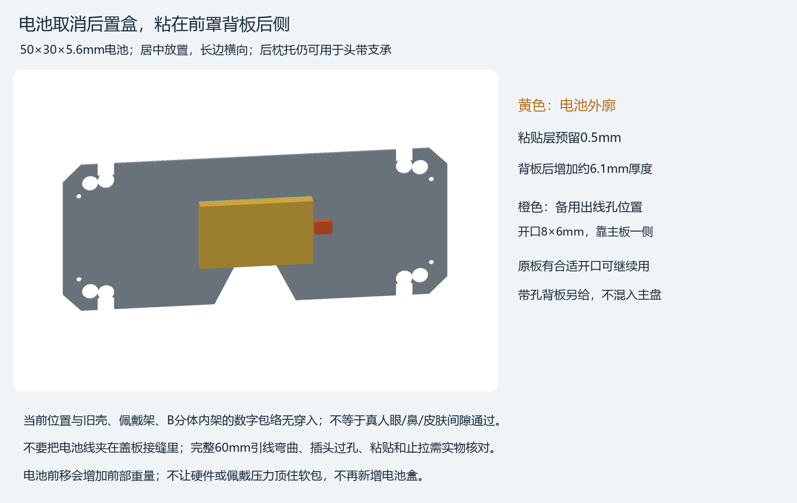

# v0.5小盒装配顺序

对应[8件主盘](ArcMask_v05_A1_PETG_M2x10_8parts.3mf)，全部单色PETG即可。先断开电池和USB，完成机械试合后再供电。零件名中的H是振动盒，S是扬声器盒；两只振动盒装法相同。

## 1. 清支撑、辨认本体

- H01是振动盒体，H02是带两个穿带桥的盖子，H03是有两个六角窝的小螺母定位条，每种各2个。H03是需要保留的小件，不是支撑。
- S01是带出音槽的扬声器盒体，S02是穿带盖，各1个。
- 只有三个盖子有生成支撑。先剪散外侧支撑，再朝远离穿带桥/螺母耳的方向逐块清理；内台、短柱、穿带桥、小定位条和盖子内耳都要保留。
- 凹位里有残丝先清理，螺母应能摆正，不靠拧螺丝硬压进不合适的六角窝。

## 2. 每只振动盒：先固定PCB，再装盖

1. 将2颗普通M3螺母从H03定位条的**下面两个六角开口**放入。平放翻转时用手托住，定位条装到板上后由板面封住开口。
2. 将模块放入H01：马达、弯针和杜邦头朝开口/盖子方向，背面焊点朝盒底。接头朝居中的出线口。PCB两孔对上盒内两座，远端PCB边落在支承条上；不能让焊点先顶住盒底。
3. 将带螺母的H03从上面盖到两孔上，两个六角窝朝PCB。中间细桥绕开接头与元件；它固定螺母并限制转动，不压马达或拉紧杜邦头。
4. 从H01**底面两个圆凹位**放入现有M3盘头，穿过支承、PCB孔，旋入定位条里的螺母。交替轻拧至板不晃即可。螺丝头应留在凹位内；若板不能自然坐平，先找顶碰，不用螺丝拉平。
5. 保留原杜邦接头，把自由导线从盒体端部居中槽向外放好。槽从开口可放线，不需剪掉接头。
6. H02盖子先离开盒体，把2颗普通M2螺母从盖子内侧**下方开口**装入端部六角位。装回盖子时托住螺母，避免滑出。
7. 盖子自然合上后，用2颗M2×10分别从盒体两端水平拧入。两个孔分别偏在两侧，避开中心出线，不要把线塞到螺丝旁。确认不夹线、不靠拧紧强行合盖。
8. 另一只同样安装。穿到左右带后轻拉导线检查接头不承拉；外侧沿带固定线束，盒口附近保留松弯。

本版不增加软隔振组件。PCB通过螺丝与支承连到本侧盒底，盒底朝头、穿带桥朝外；厚泡棉包满盒体会改变传振，不能先填满胶再判断触感。实际左右串振和触感仍需试戴确认。

## 3. 扬声器盒：先单元和线，再从侧面锁盖

1. S01出音槽朝外部出声方向，S02穿带桥朝绑带。单元正面朝S01出音槽，短边引线朝盒体端部开放槽。
2. 先放2209单元，确认22×9×4本体自然落入；不要以压盖的力量把它挤进盒内。前面预留约0.4mm硬边密封层，侧导向各有约0.2mm试配间隙。
3. 仅沿**实际硬边**加很薄的定位/密封材料，避开振膜和焊点。图里完整长方体是最大包络，不代表背面磁体填满四角；盖内短指只限制向后窜动，不要求它们把磁体压紧。硬边位置不够时先停止贴垫，不能用胶铺满振膜一面。
4. 从上方把原线放进端部居中槽。盖上后导线应松动自由、不被盖边剪夹；线束止拉在盒外沿带设置。
5. 先把2颗普通M2螺母装到S02盖子两端的侧槽，合上盖子。用2颗M2×10从S01**侧面两个孔**水平拧入，尾端进入盒体盲孔，不碰单元。
6. 按实际耳朵位置调整盒子的带上位置，保证出音槽露出，不被织带、皮肤或泡棉堵住。先检查声音是否闷/破音以及单元是否晃动，再固定最终位置。

橙色是Ø6mm工具空间，黑色是25mm宽/2.5mm厚织带预算。振动盖从两端拧，扬声器盖从侧面拧。正常织带位于盖子上方的桥内，不能额外绕到这些孔口下面。

## 4. 穿带和原线

盖子带槽净口26.5×4.2mm，按25mm织带、单层厚≤2.5mm设计；自由尾端从两个桥下面依次穿过。加厚缝头、扣具、铁环不要求强塞过槽，先退开自由端。实际带厚和穿带手感仍未实测。

沿左右绑带外侧分别固定对应振动线，接头附近留小松弯。扬声器线沿实际安装侧返回主板；80mm原线够不到才延长该段。各类针序和原电路不改，不按图中色彩重接线。24AWG外径1.6mm比原线粗，新线数量和转弯要现场检查，不能把多根粗线硬塞入原开放槽。

## 5. 电池粘到前罩背板

不打印电池盒。先将50×30×5.6电池按图居中试摆，长边横向、引线短边朝主板，接头断电保持。背板后预留0.5mm粘贴层，加电池约占6.1mm厚；确认鼻/眼/皮肤和佩戴架不压软包后再粘。

原背板已有能用的开口便继续用；否则使用[可选带孔背板](OPTIONAL_Backplate_A1_PETG_1part.3mf)。新孔8×6靠主板，先不粘电池，试穿实际插头和完整60mm引线；不把线夹在盖缝里，也不要带着电池钻/切板。后枕托仍作头带支承，旧电池盒不用安装。

装好后的第一轮只核对坐平、螺母防转、合盖、穿带、夹线和位置，再检查声音/触感及短时佩戴。数字无干涉不代表已验证贴头间隙、胶的保持力或打印件强度。
