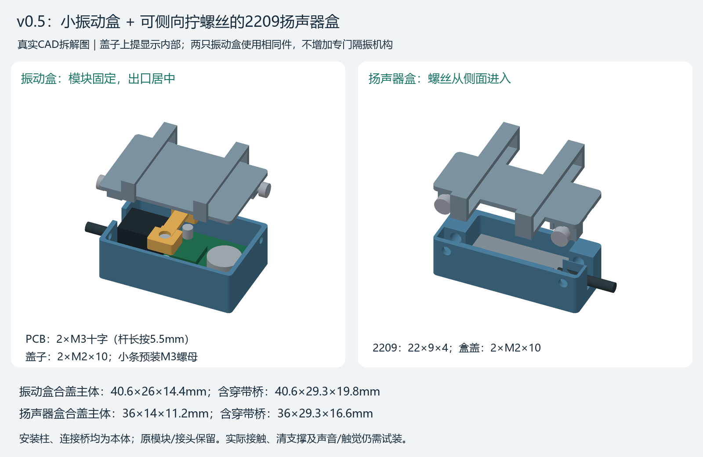
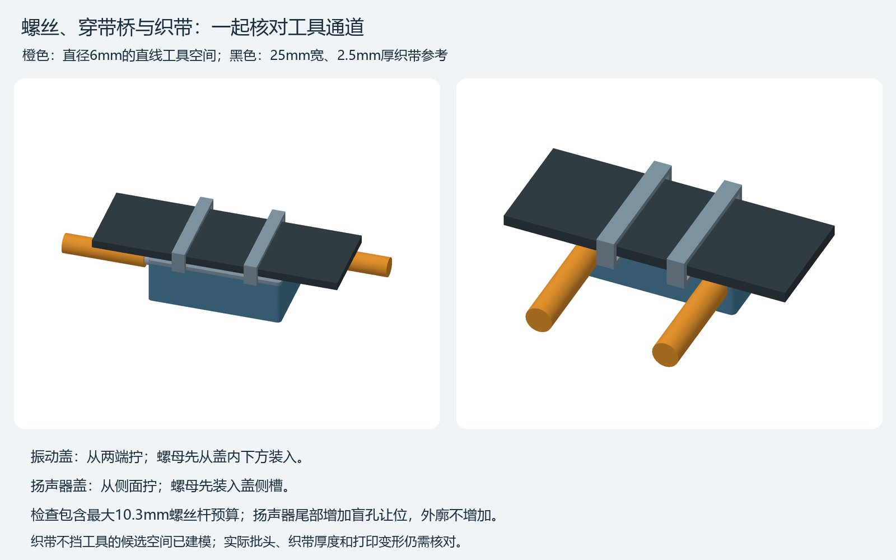
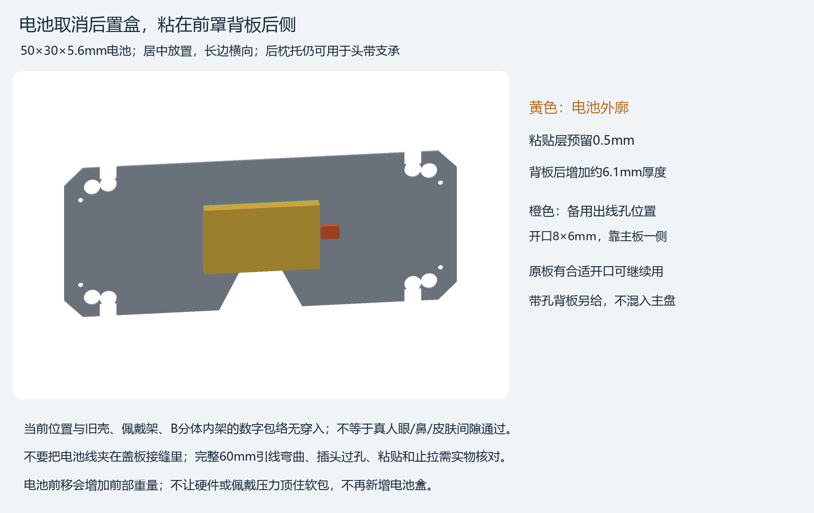

# ArcMask v0.5：小振动盒与2209扬声器盒

> 提交版只附完成后的结构模型、打印文件、图示和说明；本目录原说明中提及的生成脚本与参数文件不随包附带。

本版替换两只旧振动大盒和原扬声器盒，保留完整模块、现有接头和前部B分体内架。振动PCB用自身两孔固定；扬声器盒盖改从侧面拧。用户确认现有M3为平底盘头，按头下杆长5.5、头径5、头高约1.2mm适配；盒盖使用现有M2×10。没有新增电池盒。

## 打印入口

- **[主盘：8件、A1/PETG、M2×10版本](ArcMask_v05_A1_PETG_M2x10_8parts.3mf)**。两只振动盒各含盒体、盖子、M3螺母定位条，共6件；扬声器盒体、盖子共2件。切片预测 **2小时10分47秒、19.35g**，不包含电子/螺丝/织带。
- **[可选：带出线孔的前罩背板，单盘1件](OPTIONAL_Backplate_A1_PETG_1part.3mf)**。预测56分47秒、12.99g；原背板已有合适开口便不用打。此件未混入主盘。
- [装配顺序](ASSEMBLY.md)、[螺丝螺母表](FASTENERS.md)、[离线旋转查看](peripherals_viewer.html)。网页下载后本地打开。

两只振动盒用相同零件，装到左右绑带上；左右方向靠实际布线和摆位确定，不需要镜像打印。图中的金色定位条也是PETG打印件，主盘全部单色即可。

## 外廓与改变

尺寸依次为沿带方向×跨带方向×离头方向厚度，单位mm。螺丝头局部外突不计入表内塑料外廓。

| 盒体 | 合盖主体 | 含穿带桥的塑料外廓 | 固定方式 |
|---|---|---|---|
| 每只振动盒 | 40.6×26×14.4 | 40.6×29.3×19.8 | PCB：2颗M3盘头从底面凹位装入；盖：2颗M2×10从两端拧 |
| 2209扬声器盒 | 36×14×11.2 | 36×29.3×16.6 | 盖：2颗M2×10从侧面拧，避开穿带桥和织带 |

振动板用最新插接外廓36×20.8×8.8、孔距15.6、孔心距接头侧板边2.8；接头在正面居中，出线口也居中。两只小盒没有另加软隔振机构，固定路径为模块PCB→安装支承→本侧盒底；左右串振和触感需实装判断。

扬声器按实际2209外廓22×9×4避让，正面有出音槽。侧螺丝后方增加盲孔容纳M2×10尾端，不让尾端进入扬声器空间。固定和密封接触应落在单元硬边，不能压振膜；真实边框宽度未量，不能把简化图当作已验证的声学夹具。

## 电池与原线

电池取消后置盒，50×30×5.6电池居中粘在前罩背板朝头的一面，长边横向。按0.5粘贴层预算，背板后增加约6.1mm。后枕托仍可承担头带支承，不必为了拆掉旧电池接口重打。

备用背板在靠主板一侧增加8×6圆角出线孔，其余接口保持。图中橙色是孔的位置参考；不是说原背板已经开孔。先试摆确认眼/鼻/皮肤和承力件不顶电池，再粘贴；不把电池线夹在盖缝中。原60mm引线是否够走完整路线、实际插头能否过孔以及粘贴强度仍需实装。

新盒出线槽均能从开盖状态放入导线，不要求剪掉旧接头或把全部原线换成24AWG。出口不是止拉夹：导线沿绑带外侧固定，接头附近留松弯，避免拉力直接作用到杜邦头。24AWG硅胶线外径1.6只用于确实需要延长的段，不能默认原尺寸线口能容纳任意根1.6mm粗线。

## 已保存的切片配置

A1、0.4mm喷嘴、PETG、0.2mm层高、4墙、20%陀螺填充，喷嘴255℃、纹理PEI床80℃、体积速度上限8mm³/s；温度仍以实验室具体耗材为准。

盒体平底贴床，定位条平放；仅3个盖子使用普通自动贴合支撑、0.2mm接触间隙和4mm外裙边。不要全盘统一开启支撑或自动重新朝向。冷却后分块拆支撑，**穿带桥、M3定位条、内支承和盖子螺母耳均是本体**。凹位残丝要清理后再装螺母，不能靠螺丝硬拉到位。

## 核验范围

- [54项CAD/STEP/STL检查](qa/validation.json)：当前五种零件单实体、闭合网格、盒/简化模块/紧固件避让、螺母装入和直线工具通道；工具检查包含25mm宽、2.5mm厚织带预算。
- [主盘实际3MF/G-code核验](qa/primary_project_verification.json)：1盘8件，当前STL相同几何，无缩放/漏切/越床；实际支撑只在3个盖子。
- [电池17项数字检查](qa/battery_layout_check.json)及[可选背板切片](qa/optional_backplate_project_verification.json)。最初电池偏上位置碰佩戴架的失败记录保留，当前已下移居中；旧模型没有被覆盖。

这些检查不代替试装。孔排横向居中、背面焊点不超过2.3mm预算、接头宽不超过10mm预算、实际M2头部/螺母、带厚、打印强度、扬声器硬边接触、触感/串振及电池贴头间隙仍待实物核对。当前`all_checks_passed=false`，未发送打印机或操作电子设备。

源码为model.py（建模生成资料仅留原工程，本包未收录）/parameters.json（建模生成资料仅留原工程，本包未收录），STEP与落床STL分别在`step_parts/`、`stl_print/`。旧未交付6件草稿收在`qa/`，不要选它打印；现用文件名明确含`M2x10_8parts`。
