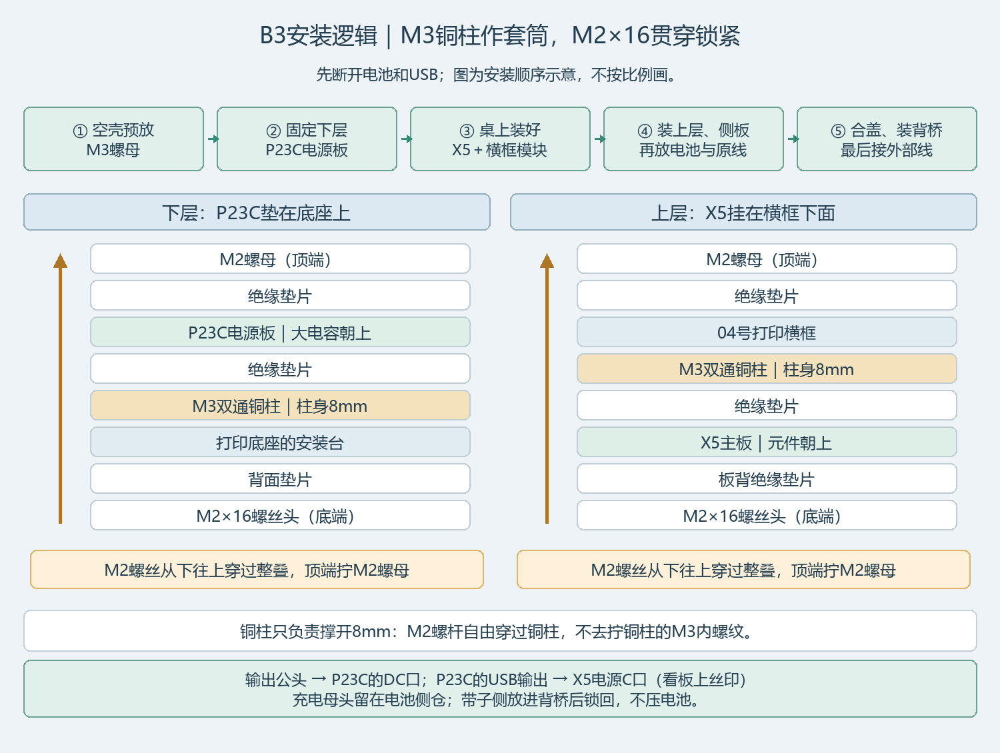

# 安装简明说明 · 当前M3套筒/M2贯穿装法

先断开电池和USB，整套孔位与原3MF不变。

1. 空壳先预放M3螺母，部分槽口装完侧板就不好进了。
2. 下层P23C大电容朝上，4个8mm铜柱垫在底座安装台与板之间；M2×16从底座背面穿上来，配绝缘垫和板上M2螺母。四个角同样装，轻锁到不晃。
3. 上层X5先在桌上装成模块：铜柱放在X5上方、横框下方。M2×16从X5板背穿上去，经过铜柱、横框，配垫片和横框上方M2螺母。然后整组落入空壳，用4颗M3×10固定横框。
4. 装三块服务侧板（共8颗M3×10），电池垫薄软垫放旁仓。输出公头原线从开放出线槽侧放进去，充电母头留侧边口袋；只做轻束止拉，不夹进盖缝。
5. 计算盖3颗、电池盖4颗M3×10最后合。背桥拆下放入50mm带，再用4颗M3×16装回；合盖后再接外线：电池输出公头到P23C DC口，P23C USB输出到X5电源C口，按实物丝印识别。

每块板都用M3×8贯通双通铜柱4个、M2×16螺丝4颗、M2螺母4个；保留三处垫片。M3铜柱只当套筒，不啮合M2螺丝。柱长必须8mm、对边≤5.5mm且M2杆能自由穿过，不扩X5的Ø2.5孔，不用热熔胶承重。

这是装配顺序说明，非实物插拔/承载/热验收。横框、侧板和背桥的实际外形见[九件认件图](images/04_九件认件.png)与[三维拆分图](images/02_拆分与顺序.png)。本次未改CAD、STL或3MF。
