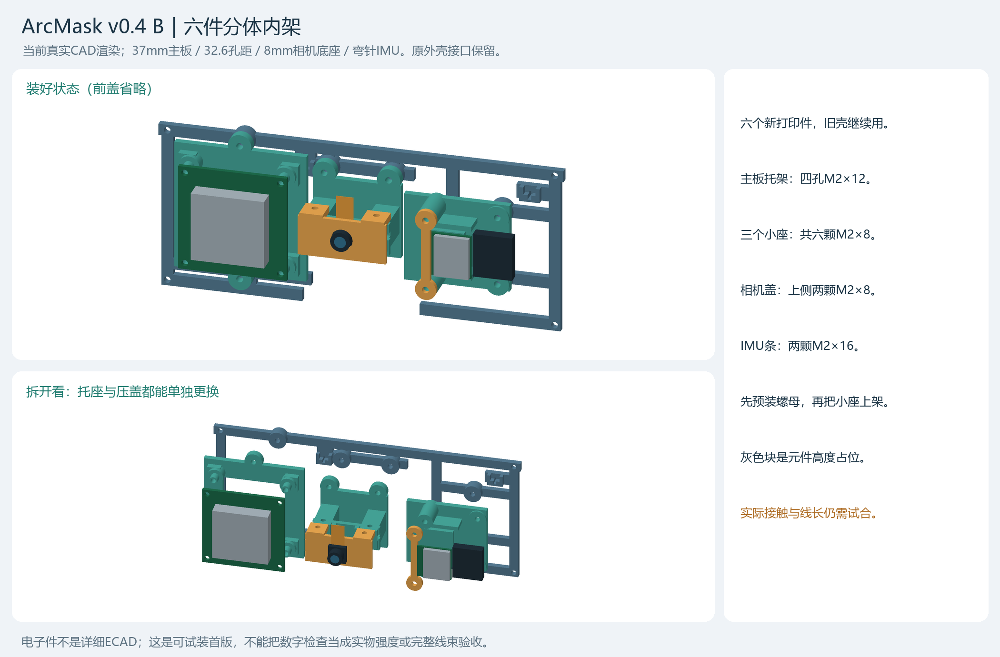

# 云瞳助行 · 智能助盲眼镜工程原型

基于 **ESP32-S3 + OV3660 + RDK X5** 的视觉辅助感知原型。本提交包整理当前地面障碍提示代码、ESP 固件源码、模型、结构模型及打印文件，供项目提交、代码阅读与受限场景复现。

**版本：2026-11-03 提交整理版。** 当前主入口是 2026-11-01 持续试装演示；2026-11-02 的盲道联调代码单独保留为实验候选。电脑参与图像中继、后处理、界面与提示调度，尚不能脱离电脑独立运行。项目当前没有完整导航、路径规划、测距或独立场景准确率验收。



## 从这里开始

| 目的 | 文档 / 入口 |
|---|---|
| 看项目内容和验证范围 | [项目提交说明](docs/SUBMISSION.md)、[实现状态](docs/STATUS.md) |
| 安装电脑环境、配置设备 | [安装与部署](docs/SETUP.md) |
| 不接硬件先检查模型 | `python scripts/offline_demo.py` |
| 连接硬件使用 | [使用说明与排障](docs/USAGE.md)、[启动演示.cmd](启动演示.cmd) |
| 核对硬件模块与接口 | [硬件和接口](docs/HARDWARE.md) |
| 查看、修改和打印结构 | [建模与装配说明](docs/MECHANICAL.md)、[建模目录](3D打印文件/) |
| 核验文件和准备 Git 提交 | `python scripts/verify_repository.py`、[GitHub 提交步骤](docs/GITHUB.md) |
| 看来源与授权状态 | [第三方说明](THIRD_PARTY_NOTICES.md)、[本项目授权说明](RIGHTS.md) |

## 工程内容

```text
benchmarks/
  ground_demo_20261101/          当前地面演示、后处理、串行声振调度及测试
  ground_route_screen_20261031/  TinyTaskProbe 训练、ONNX 模型及开发样本
  ground_tactile_joint_20261102/ 盲道联调候选源码（外部盲道权重另备）
hardware_test/
  esp_dataset_capture/          MJPEG 解析、采集界面与软件测试
firmware/esp32s3/               当前 ESP-IDF 工程的脱敏源码与配置
3D打印文件/                    头戴和计算盒 STEP、STL、3MF、装配图
config/                        本地设备配置示例
scripts/                       启动、离线检查、文件核验
docs/                          安装、使用、装配、状态与提交说明
submission/                    文件清单、来源映射、整理差异与核验结果
```

保留必要的原工程相对路径，使模型和开发样本引用可以直接解析；历史实验大目录、环境、凭据、个人申报表及原始视频不在本包内。

## 快速运行

在 Windows PowerShell 中进入本仓库根目录：

```powershell
py -3.10 -m venv .venv
.\.venv\Scripts\python.exe -m pip install -r requirements.txt
.\.venv\Scripts\python.exe scripts/verify_repository.py
.\.venv\Scripts\python.exe scripts/offline_demo.py
```

离线入口使用已收录的 32 张开发图和真实 ONNX 推理，在 `outputs/offline_demo/` 生成预测图与摘要；不访问设备、不发送声振。这些已见场景只用于检查可运行性，不能作为独立测试集。

连接实机前按[安装说明](docs/SETUP.md)填写 `config/device.local.json`。然后双击 `启动演示.cmd`；提交版入口默认声振关闭、等待手动开始。按[使用说明](docs/USAGE.md)确认画面后再启用所需反馈。

## 当前运行链路

ESP 摄像头 → MJPEG → 电脑接收 → SSH 调用 X5 BIN → 电脑计算地面缺口与方位 → 界面 / ESP 语音与短振。也可选择 PC ONNX 后端，此时推理发生在电脑。

当前模型为小样本从头训练的 **TinyTaskProbe 纯地面二分类 CNN**，并非 PP-LiteSeg。地面缺口产生障碍候选，左 / 中 / 右表示图像中的障碍方向，不是建议绕行方向。蓝色物体、侧缘目标和复杂场景仍有漏检或合框；无提示不等于可以安全通行。

头戴结构已完成用户制作装配反馈；计算盒、局部结构强度、温升、续航、长期佩戴和盲道纠偏仍有待验项。具体数据口径及最新图传中断问题见[状态说明](docs/STATUS.md)。
