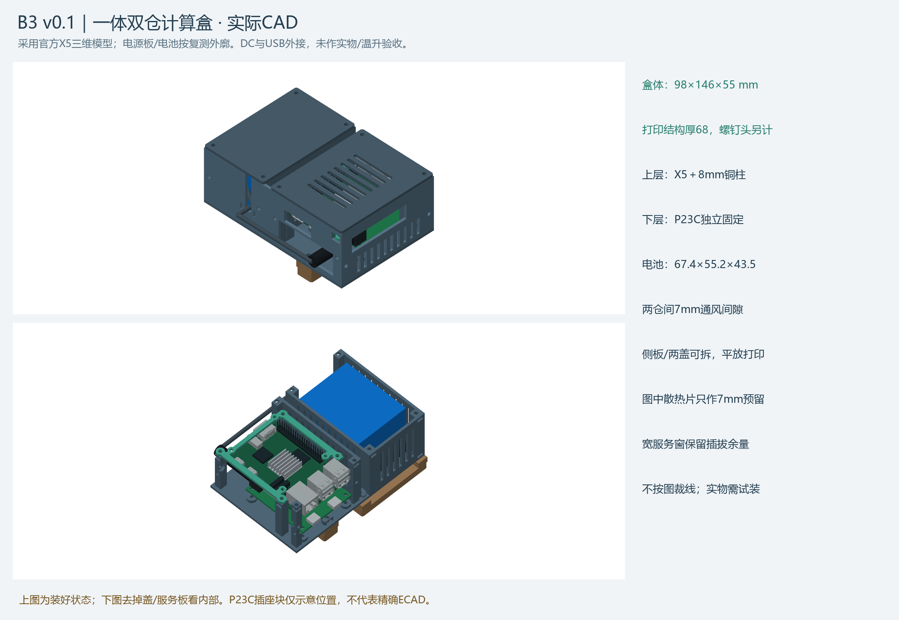

# 建模、打印与装配说明

## 当前组合

头戴部分由不同批次的模块组成，不能把“最新目录”当成整机全部零件，也不能把历史全套 STEP 中已被替换的内架再打一次。

| 模块 | 使用目录 | 使用范围 |
|---|---|---|
| 前壳、前盖、眼侧隔板、小盖、加固额托 / 脸架、连接片 | `ArcMask_v0_3_1_补打加固_20261031` | 作为基础外壳与佩戴架；旧电子内架 / 旧相机夹 / 旧外围盒由下列版本替换 |
| 主板、相机、IMU 分体内架 | `ArcMask_v0_4_B分体内架_20261031` | 六件 B01—B06，替换旧 A2/A6/A7/A8 相关夹持结构 |
| 左右振动盒、2209 扬声器盒 | `ArcMask_v0_5_小振动盒与喇叭修正_20261101` | 主盘八件；带线孔背板为可选单件 |
| 后枕托 | `ArcMask_后枕托穿带修正_20261101` | 单件修订，带口 26.5×6mm；电池接口保留但不要求装旧电池盒 |
| 计算端盒体 | `RDKX5_B3_v0_1_分仓计算盒_20261102` | 九个打印件，RDK X5 / P23C / 计算端电池分仓 |

v0.5 的头戴电池按 50×30×5.6mm 包络居中粘在前罩背板朝头侧，不再使用旧后置电池盒；与计算盒内的大电池不是同一块。粘贴、走线、绝缘和皮肤间隙仍按实物检查。

## 文件类型

| 文件 | 用法 |
|---|---|
| 单件 `.step` | 可编辑实体，通常保留装配坐标 |
| 单件 `.stl` | 网格打印文件，通常已按预定方向落床，单位 mm |
| `.3mf` | 原 A1 / 0.4mm / PETG 切片工程；作为工程打开，复核机器、耗材、比例、支撑和盘数 |
| 合装 STEP | 总装与干涉查看，**不能作为一个打印件整体切片** |
| 自包含 `.html` | 离线三维旋转查看；颜色用于区分零件 / 占位 |
| `qa/`、图示 | 原数字检查、部件清单、切片核对与 CAD 渲染；不是强度 / 温升实测 |

基础 v0.3.1 里的五件补打 3MF 只含加固件，不含两块复用盖板。首次从零制造应按本组合表从各目录的单件 STEP / STL 选件，重新核对摆盘；不能只打印某一个“补打盘”。原模型目录含历史已替换件，顶层组合表优先于子目录旧说明。

## 打开与修改模型

本包只保留完成后的模型、打印工程、图示和说明，不附生成模型的 Python 脚本、参数文件及 CAD 开发环境。它们仍保存在原工程中。

查看或修改实体可用支持 STEP 的 CAD 软件；打印使用单件 STL 或已有 3MF 工程，不需要运行建模代码。各模块旧说明中提及的生成、渲染和校验脚本属于原工作区记录，不是本包操作入口。本次没有重新建模、修改几何或重新切片。

## 安装顺序

断电后先清支撑、空件试孔、试放螺母。按基础外壳、B 分体内架、前后盖、额托 / 连接片、头带后托、外围盒的顺序试装；对应各模块 `ASSEMBLY.md` 和图示。主板孔位、相机塑料底座、IMU 针脚与接头均以现有实物为准，不能依照已撤回的旧夹层假设强拧。

保留原线束和插头，出口轻束止拉、接头留松弯；电池不承担受压定位。左右按戴上后的方向区分，软件 left/right 与实际振动盒需现场核对。

## 计算盒 B3

主体 98×146×55mm，打印件含背桥包络约 101×146×68mm；外部插头和软垫另计。九件单盘切片预测 13:07:52 / 170.46g，不是实打计时或称重。保留原安装图和 `安装简明说明.md`。

正式方案使用 M2.5 铜柱。已接受的临时方案为八个 M3×8 贯通双通铜柱作套筒、八颗 M2×16 螺丝和八个 M2 螺母；M2 杆穿过套筒，不与 M3 内螺纹啮合，不扩 X5 原 Ø2.5 安装孔。两方案复用九个打印件。

P23C 插座为保守包络 / 位置示意，外部线弯、插拔工具空间、带子承载及无风扇温升仍待实物检查。模型中的散热片仅为空间预留。
